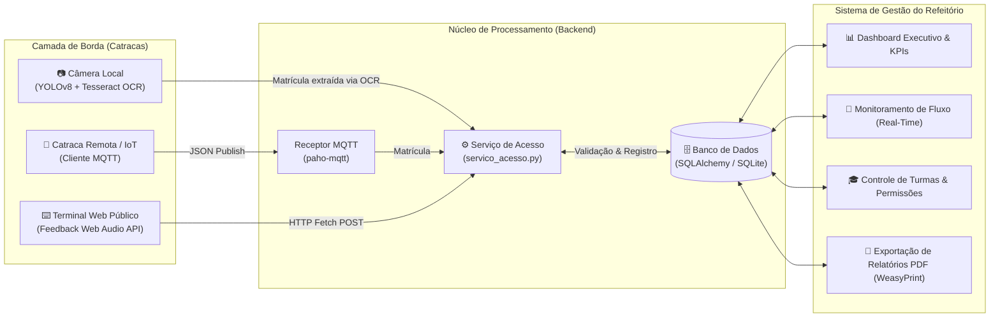

# 🍽️ Smart Access — Sistema Integrado de Catraca Inteligente (Visão Computacional & IoT/MQTT) e Gestão de Refeitório


---

## 📌 Visão Geral do Projeto

O **Smart Access (Catraca & Gestão de Refeitório)** é uma plataforma completa que integra **Visão Computacional (YOLOv8 + Tesseract OCR)**, **Comunicação IoT via protocolo MQTT** e um **Sistema Web de Gestão Executiva em Tempo Real (Flask + SQLAlchemy)** para controle automatizado de acesso em refeitórios estudantis e corporativos.

O projeto soluciona o problema de filas e controle manual em horários de pico através de uma **arquitetura híbrida e unificada**:
1. **Catraca com Visão Computacional (`camera_catraca.py`):** Detecta automaticamente a carteirinha estudantil (física ou digital no celular) utilizando um modelo **YOLOv8** customizado (`modelo_catraca.pt`), recorta a região da matrícula e extrai os dígitos via **Tesseract OCR**.
2. **Comunicação Distribuída via MQTT (`receptor_mqtt.py`):** Permite que múltiplas catracas físicas/remotas publiquem leituras em um *broker* MQTT (`isaac/catraca/leitura`), sendo processadas instantaneamente pelo servidor central.
3. **Motor Único de Regras de Negócio (`servico_acesso.py`):** Centraliza a validação de permissões por turma/aluno, janelas de horários de refeições e prevenção de passagens duplicadas, persistindo os eventos diretamente no banco de dados do Dashboard.

---

## 🏗️ Arquitetura de Comunicação (Catraca ↔ Gestão)



---

## ⚙️ Regras de Negócio e Validação de Acesso

O motor central (`servico_acesso.processar_matricula`) valida cada tentativa de acesso na catraca em tempo real, garantindo que **cada estudante registre apenas uma única passagem por refeição, por dia**:

| Status Retornado | Comportamento na Catraca / Terminal | Descrição da Regra |
| :--- | :---: | :--- |
| **`entrada`** | 🟢 **Catraca Liberada** + Beep Ascendente | Aluno cadastrado, com permissão ativa e dentro da janela de refeição vigente. |
| **`duplicado`** | 🟠 **Acesso Recusado** + Alerta | O aluno já realizou uma passagem válida nesta mesma refeição hoje. |
| **`fora_horario`** | 🟠 **Acesso Recusado** + Alerta | Tentativa de leitura fora das janelas configuradas (ex.: Café, Almoço, Jantar). |
| **`refeicao_bloqueada`** | 🔴 **Acesso Bloqueado** + Tom Grave | A janela de refeição atual foi temporariamente suspensa pela administração. |
| **`bloqueado`** | 🔴 **Acesso Bloqueado** + Tom Grave | Aluno ou turma com permissão de acesso desativada no sistema. |
| **`nao_cadastrado`** | 🔴 **Matrícula Inválida** + Shake UI | Número de matrícula não encontrado na base de dados. |

---

## ✨ Funcionalidades do Sistema de Gestão

- **📊 Dashboard Executivo (`/dashboard`):** Indicadores em tempo real (total de passagens do dia, horário de pico de movimento, distribuição percentual por refeição e gráficos interativos).
- **🔄 Monitoramento de Fluxo Ao Vivo (`/fluxo_refeitorio`):** Tabela dinâmica com *polling* assíncrono a cada 3 segundos, exibindo cada estudante que acabou de passar pela catraca.
- **🍽️ Gestão de Janelas de Refeições (`/refeicoes`):** Criação, edição e bloqueio instantâneo de turnos de refeições (ex.: Café da Manhã `06:00–09:00`, Almoço `11:00–14:00`, Jantar `17:00–20:00`) com validação contra sobreposição de horários.
- **🎓 Gestão de Turmas e Alunos (`/gestao_turmas`):** Liberação ou bloqueio em lote de turmas inteiras ou de estudantes individuais, além de importação automatizada via planilha (`.ods`).
- **📄 Relatórios Auditáveis em PDF (`/relatorio_refeicoes`):** Geração de relatórios filtrados por período, curso, turma e refeição utilizando **WeasyPrint**.
- **🔊 Terminal Público de Acesso Rápido (`/`):** Interface para totem/catraca com síntese sonora nativa via **Web Audio API** (tons distintos para liberação e bloqueio sem necessidade de arquivos de áudio externos).

---

## 🚀 Como Executar o Projeto

### 1. Pré-requisitos
- **Python 3.10+**
- **Tesseract-OCR** instalado no sistema operacional (necessário apenas para o módulo de câmera/OCR):
  - **Windows:** `C:\Program Files\Tesseract-OCR\tesseract.exe` (detectado automaticamente)
  - **Linux:** `sudo apt install tesseract-ocr`
  - **macOS:** `brew install tesseract`

### 2. Instalação das Dependências
```bash
pip install -r requirements.txt
```

### 3. Inicialização do Banco de Dados (Dados Sintéticos de Demonstração)
O projeto respeita a privacidade de dados (LGPD) e não armazena informações reais de estudantes no repositório. O script `seed.py` gera automaticamente contas administrativas, janelas de refeições, **36 estudantes fictícios** (com matrículas no padrão `20261000001` a `20261000036`) e histórico simulado dos últimos 30 dias:

```bash
python seed.py
```

### 4. Subindo o Sistema (Catraca + Dashboard)
```bash
# Inicia o Dashboard Web + Câmera Integrada (YOLOv8 + OCR)
python run.py

# Inicia apenas o servidor Web de Gestão (sem exigir webcam conectada)
python run.py --sem-camera

# Inicia o servidor escutando também catracas remotas via broker MQTT
python run.py --sem-camera --mqtt
```

Acesse no navegador:
- **Terminal da Catraca (Acesso Rápido):** `http://localhost:5000/` *(experimente digitar a matrícula `20261000001`)*
- **Painel Administrativo / Gestão:** `http://localhost:5000/login`
  - **Credenciais de Demonstração:** Matrícula `1` | Senha `1` (Admin) ou Matrícula `0` | Senha `0` (Master).

### 5. Executando os Testes Automatizados
A suíte de testes utiliza banco SQLite isolado em memória (`sqlite:///:memory:`):
```bash
python -m unittest tests/test_publico.py -v
```

---

## 📂 Estrutura do Repositório

```text
├── run.py                      # Ponto de entrada unificado (Flask Thread + OpenCV Main Loop + MQTT)
├── camera_catraca.py           # Pipeline de Visão Computacional (YOLOv8 + Tesseract OCR)
├── servico_acesso.py           # Motor central de regras de negócio e validação de passagens
├── receptor_mqtt.py            # Cliente/Subscriber MQTT para comunicação com catracas remotas
├── modelo_catraca.pt           # Pesos treinados da rede YOLOv8 (detecção de carteirinha e matrícula)
├── treino.py & config.yaml     # Scripts de treinamento do modelo YOLO
├── coleta_imagem.py            # Utilitário para captura de dataset pela webcam
├── app.py                      # Configuração da aplicação Flask, CSRF e banco SQLAlchemy
├── models.py                   # Modelos ORM (Servidor, Aluno, Refeicao, Log, TurmaStatus)
├── routes.py                   # Rotas da aplicação, APIs JSON e geração de PDF
├── seed.py                     # Gerador de banco de dados sintético para demonstração
├── static/                     # Design System CSS, scripts JS assíncronos e ativos visuais
├── templates/                  # Interfaces Jinja2 (Totem da Catraca, Dashboard, Fluxo, Relatórios)
└── tests/                      # Testes automatizados de integração (unittest)
```

---

## 🤝 Autores e Contribuidores

Este projeto foi desenvolvido de forma colaborativa pela equipe responsável pela arquitetura de Visão Computacional, comunicação IoT/MQTT, Backend e Frontend do sistema:

- **Isaac Salles Gonçalves** — [@totemicpuma](https://github.com/totemicpuma)
- **Gian Verdan** — [@GianXim](https://github.com/GianXim)
- **Fellipe** — [@Lxpxx](https://github.com/Lxpxx)
- **Ray Gomes Pereira** — [@rayforgelab](https://github.com/rayforgelab)
